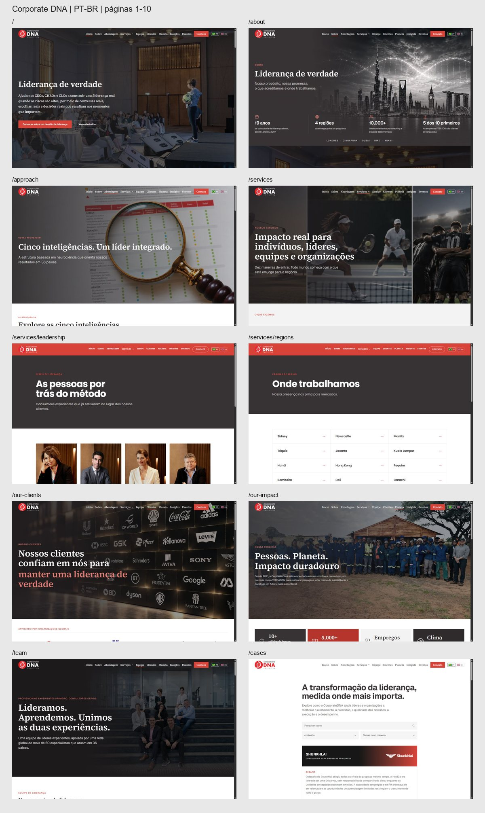
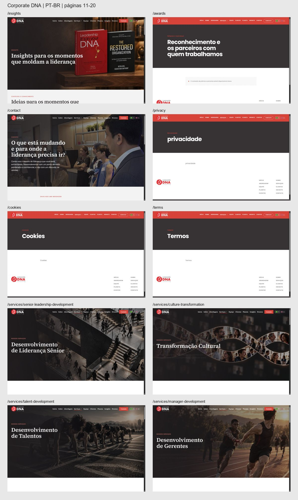
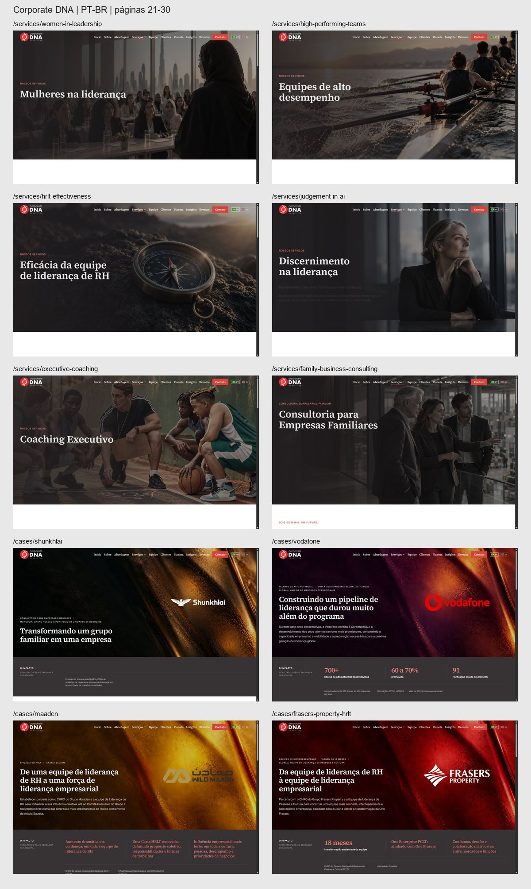
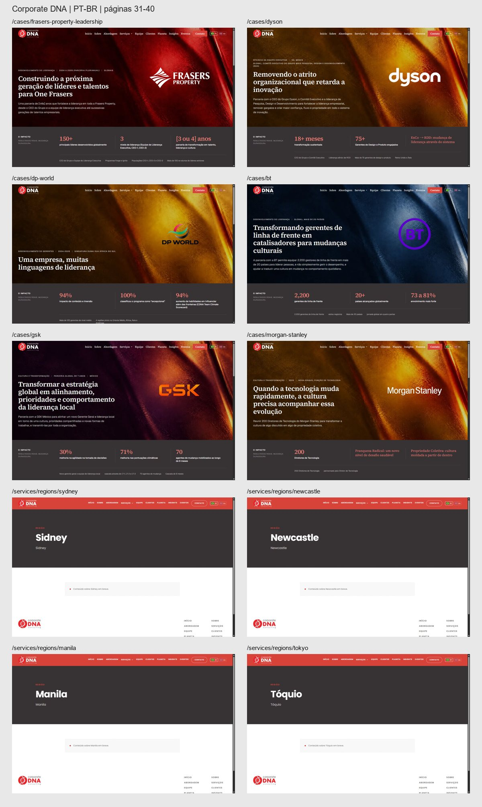
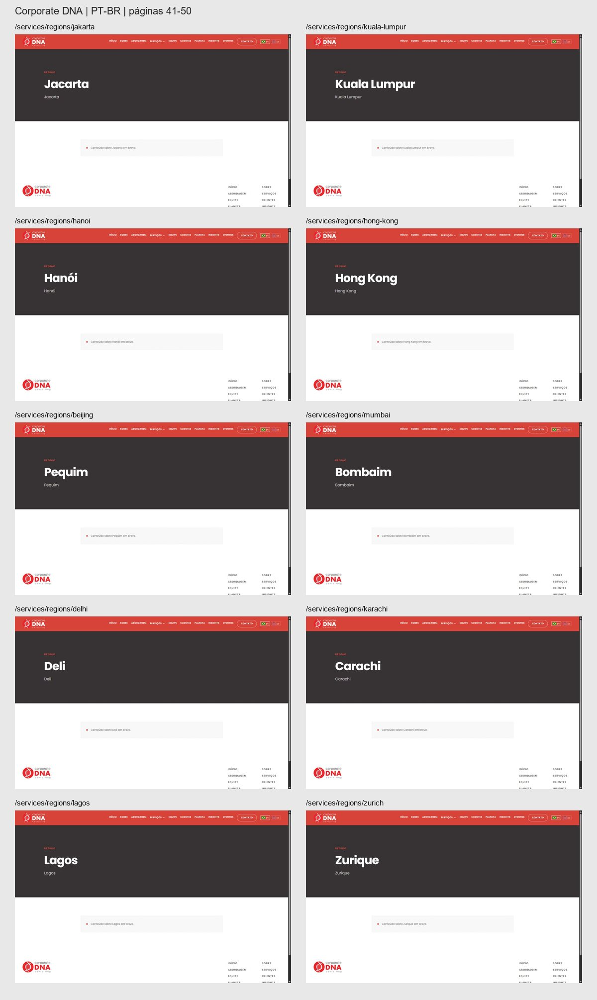
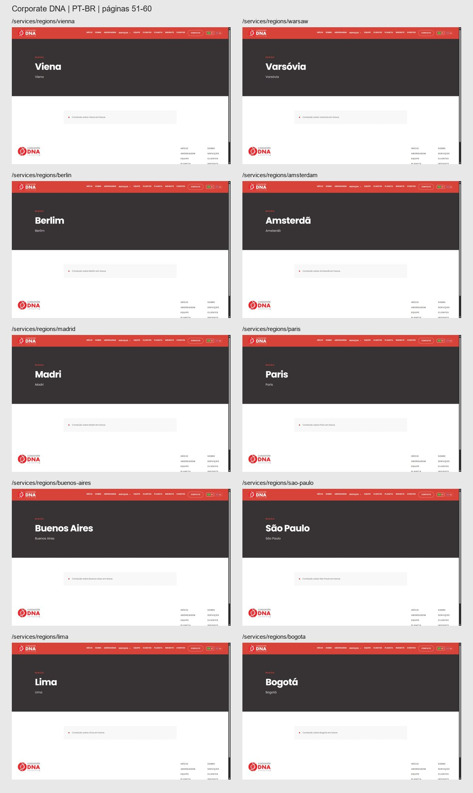
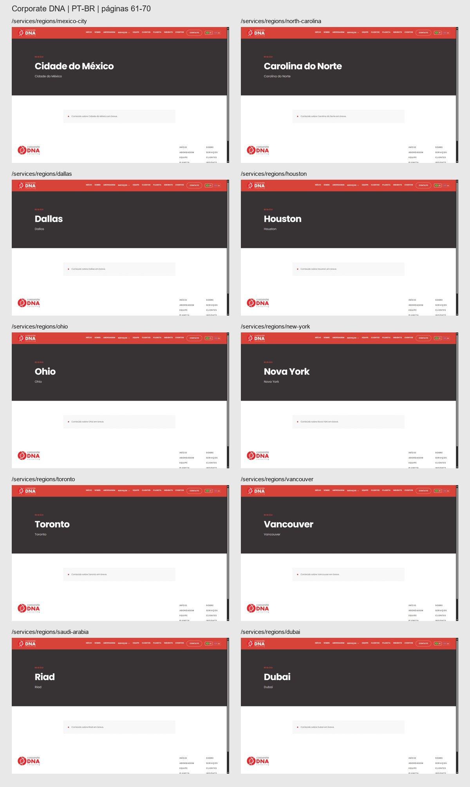
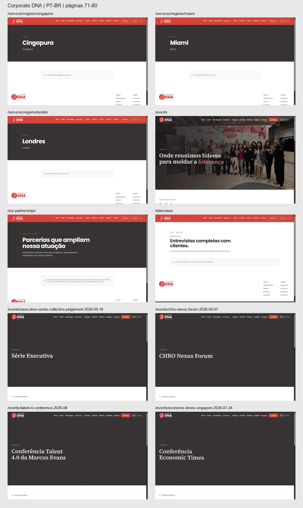
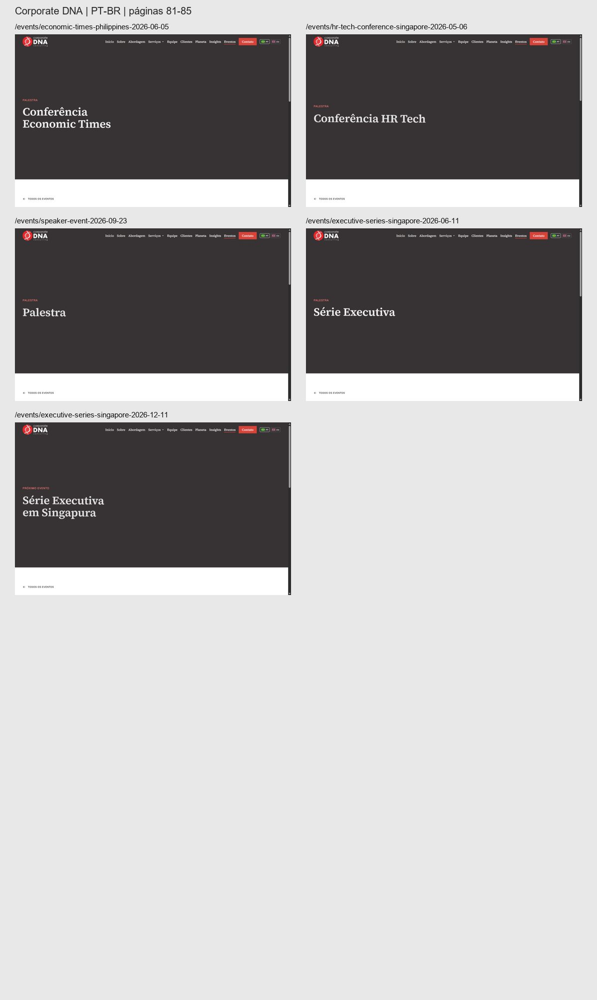

# Evidências locais da tradução PT-BR

Capturas da build local em desktop (1440 × 900), feitas após o carregamento e com `site_locale=pt-BR`. Cada painel mostra até dez páginas; as URLs e os slugs permanecem em inglês.

Os prints individuais da página inteira estão guardados nesta pasta de trabalho e não foram incluídos no Git para evitar aumentar o repositório.

## Páginas 1–10

- `/`
- `/about`
- `/approach`
- `/services`
- `/services/leadership`
- `/services/regions`
- `/our-clients`
- `/our-impact`
- `/team`
- `/cases`

## Páginas 11–20

- `/insights`
- `/awards`
- `/contact`
- `/privacy`
- `/cookies`
- `/terms`
- `/services/senior-leadership-development`
- `/services/culture-transformation`
- `/services/talent-development`
- `/services/manager-development`

## Páginas 21–30

- `/services/women-in-leadership`
- `/services/high-performing-teams`
- `/services/hrlt-effectiveness`
- `/services/judgement-in-ai`
- `/services/executive-coaching`
- `/services/family-business-consulting`
- `/cases/shunkhlai`
- `/cases/vodafone`
- `/cases/maaden`
- `/cases/frasers-property-hrlt`

## Páginas 31–40

- `/cases/frasers-property-leadership`
- `/cases/dyson`
- `/cases/dp-world`
- `/cases/bt`
- `/cases/gsk`
- `/cases/morgan-stanley`
- `/services/regions/sydney`
- `/services/regions/newcastle`
- `/services/regions/manila`
- `/services/regions/tokyo`

## Páginas 41–50

- `/services/regions/jakarta`
- `/services/regions/kuala-lumpur`
- `/services/regions/hanoi`
- `/services/regions/hong-kong`
- `/services/regions/beijing`
- `/services/regions/mumbai`
- `/services/regions/delhi`
- `/services/regions/karachi`
- `/services/regions/lagos`
- `/services/regions/zurich`

## Páginas 51–60

- `/services/regions/vienna`
- `/services/regions/warsaw`
- `/services/regions/berlin`
- `/services/regions/amsterdam`
- `/services/regions/madrid`
- `/services/regions/paris`
- `/services/regions/buenos-aires`
- `/services/regions/sao-paulo`
- `/services/regions/lima`
- `/services/regions/bogota`

## Páginas 61–70

- `/services/regions/mexico-city`
- `/services/regions/north-carolina`
- `/services/regions/dallas`
- `/services/regions/houston`
- `/services/regions/ohio`
- `/services/regions/new-york`
- `/services/regions/toronto`
- `/services/regions/vancouver`
- `/services/regions/saudi-arabia`
- `/services/regions/dubai`

## Páginas 71–80

- `/services/regions/singapore`
- `/services/regions/miami`
- `/services/regions/london`
- `/events`
- `/our-partnerships`
- `/interviews`
- `/events/executive-series-collective-judgement-2026-09-18`
- `/events/chro-nexus-forum-2026-09-07`
- `/events/talent-4-conference-2026-08`
- `/events/economic-times-singapore-2026-07-24`

## Páginas 81–85

- `/events/economic-times-philippines-2026-06-05`
- `/events/hr-tech-conference-singapore-2026-05-06`
- `/events/speaker-event-2026-09-23`
- `/events/executive-series-singapore-2026-06-11`
- `/events/executive-series-singapore-2026-12-11`

## Interações

- [Menu mobile em português](mobile-menu-pt.jpg)
- [Formulário de contato em português](contact-form-pt.jpg)
- [Validação do formulário vazio](contact-validation-pt.jpg)
