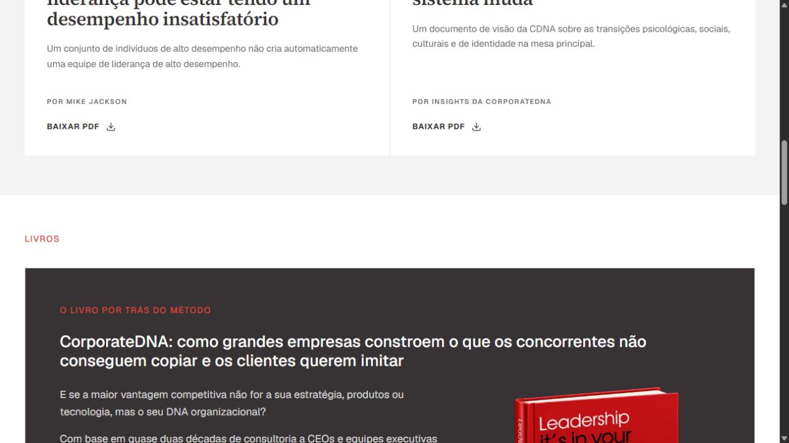

# Revisão geral da tradução PT-BR

Validação feita na build local da branch `codex/pt-br-localization`. Nenhuma alteração foi publicada em produção.

## Textos encontrados e corrigidos

| Página | Conteúdo |
| --- | --- |
| `/team` | Biografias abertas pelos botões de perfil da liderança. O conteúdo do CMS só aparece depois do clique e estava em inglês. |
| `/services/leadership` | Perfis de liderança do CMS, inclusive o perfil adicional de Phil Paul, com biografia, valores, especialidades e credenciais. |
| `/insights` | Título descritivo do livro CorporateDNA exibido fora da capa. As capas originais dos livros permanecem como obras publicadas. |

As traduções dos perfis estão em `messages/pt-BR-profiles.json` e são aplicadas pelo observador de conteúdo dinâmico em `components/LocaleRuntime.tsx`.

## Verificação local

- Varredura dos nós de texto das 85 rotas públicas listadas nas [evidências originais](README.md): nenhum trecho estático fora do catálogo de tradução.
- Abertura e leitura dos sete perfis disponíveis em `/team` e `/services/leadership` na versão PT-BR.
- Alternância PT → EN → PT em `/insights`, preservando o caminho da página e o título original em inglês na versão EN.
- `npm test`: 86 testes passaram.
- `npm run build`: compilação, TypeScript e geração das páginas concluídos.

## Prints da build local

